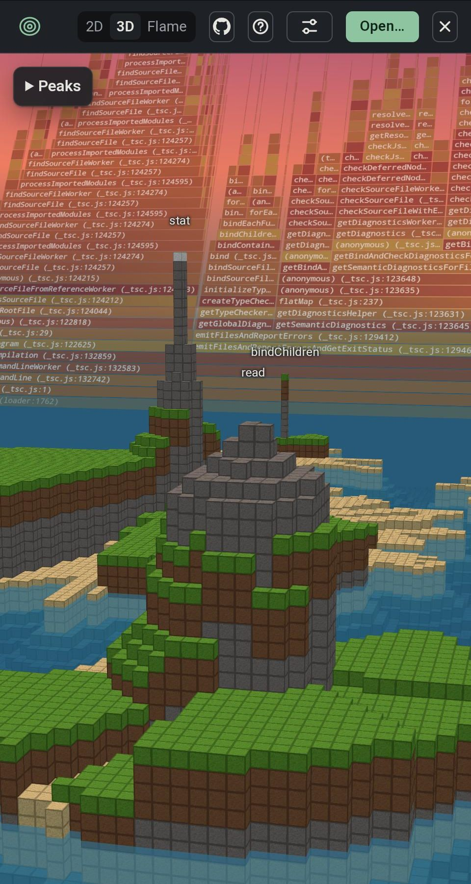

# MountainGraph

A flame graph shows where the time went, but it can only be read in one order at a time.
Top-down, it ranks the most expensive stacks. Inverted, it ranks the hot methods and spreads their
callers beneath them. MountainGraph is an experiment in using a third dimension to show both at
once.

It draws a profile as a landscape. The methods that take the most time rise as peaks (the inverted
view), and the call paths into them form the slopes (the stacks of the top-down view), down to the
entry points, a request or a thread, at the foot. The question it asks is not only *where?* but
*why do we keep ending up here?*

A heap dump reads the same way. The objects holding the most memory are the peaks, and the
references that lead to them are the slopes, out to the roots that hold everything up.

It is one static page, with no build step and no server. Drop a file on it and it works out what
the file is. A topographic map comes first, then the same terrain in 3D.


The TypeScript compiler type-checking a React front end. One peak is `stat`, the time spent in the
file system, and the flame graph of the whole profile stands behind the land.


Another view on a Java application's unit tests. Each island is a hot
spot. Two of them are real findings: `CustomTemporaryFolder` was a high source of latency in the
test run, and `CPUMemExtractor` called an expensive Windows counter, until it was optimized away.

![A Gradle daemon's allocations in 3D: the peak of char[], its callers listed in the panel, up
to the jgitver version calculation](docs/gradle-alloc-3d.png)

The allocations of a Gradle daemon. The peak, `char[]`, is 5.8 GiB, 97% of it from jgitver working
out the version from the git tags.


The same daemon in time, with the waits left out, which would otherwise be the highest peaks. The
mesa is the compile, and the island labelled `1005078208.test` is jgitver's tag filter again, 2.3
seconds of the worker's time.



The page works on a phone. Here is the TypeScript compiler again, the land in blocks: one finger
turns it, and two fingers pinch to zoom.

## Trying it

The page is published at https://pcdv.github.io/mountain-graph/, with a few profiles to open from
its landing page. A file is read in the browser and goes nowhere else.

To run it locally, Node 21 or later, with nothing to install:

```sh
npm run serve   # http://localhost:8091/ (browsers refuse modules opened from file://)
npm test        # the tests of the modules without DOM
```

## Input

Pick a file or drop it on the page, gzipped or not: the page tells what it is from its first
bytes. First, samples, of time or of allocations:

- **JFR recordings** (`.jfr`, JDK 11 and later), read in the page. A recording holds two kinds of
  samples, which weigh different things, so both are read, and a *Samples* choice in the top bar
  switches between the wall clock (Java and native samples, weighing time) and the allocations
  (weighing bytes). A recording read this way has no operations.
- **[Flamepack](https://github.com/pcdv/flamepack)** (`.fpk`, version 5, 4 or 3): collapsed stacks
  packed with a string dictionary, each sample enriched with its time, thread and operation.
  [jfr-web](https://github.com/pcdv/jfr-web) writes it from its recordings, time or allocations
  (`GET /api/sessions/:id/profile`; a static export, `jfr-web export <file.jfr> -o <dir>`, holds one
  per recording under `data/`, with `static.json` mapping `api/sessions/<id>/profile` to its file).
  jheap writes it from a heap dump (below), and any other tool can.
- **Collapsed stacks**, the text format of [FlameGraph](https://github.com/brendangregg/FlameGraph)'s
  `stackcollapse` scripts (`a;b;c 12` per line), which any profiler can produce. Their counts are
  samples, with no time, thread or operation.

Whatever the samples were read from, the file's menu saves those shown as a Flamepack, with **Save**.
The **Loss** it asks for is none at first, which writes the whole profile as a `.fpk`. A loss drops the
stacks of the methods that hardly run, where the flame graph is thin, cutting each at its deepest
caller wide enough and ending it in `(thin stacks)`. The file comes out half or a third the size.
Every sample keeps its time, thread and weight, and the methods that take time keep their peaks; the
total of a method is short by the thin stacks it is on.

The file keeps the waits, the native samples and the hidden frames, and the settings apply again
when it is opened. **Only what is shown**, with a loss, saves what the view shows instead: the
samples left out as waits, the native ones when only Java's are shown, and those outside the
interval or the operation in focus are not in the file, and the frames hidden are out of its stacks,
their time with their callers. The file is smaller, and draws as the view drew it.

**With the settings of the view** adds to either file how the page is set: the view, the shape of the
land, the peaks counted, the camera. Whoever opens the file sees what was shown. The anonymizing
rules and personal habits (the mouse, the width of the panels) are never in it.

Then the memory of a JVM:

- **Heap dumps** (`.hprof`, as jmap and jcmd write them), parsed in the page by
  [jheap](https://github.com/pcdv/jheap)'s parser compiled to WebAssembly, in a Web Worker that
  reads the file a slice at a time. A dump of 4.6 GB and 46 million objects opens in under 20
  seconds, and the page stays responsive throughout. WebAssembly addresses 4 GiB, so the page reads
  heaps up to roughly 100 million objects. Beyond that, or for a gzipped dump, the `jheap` command
  parses it and keeps the result beside it, `<name>.jheap.json`, a Flamepack the page opens as it
  would the dump. So does a heap the page saved, `<name>.fpk`. The file's menu also saves with a
  loss: the heap reduced to what the page draws, for a gallery or a report, in a
  `<name>-reduced.fpk.gz` a few percent of the dump's profile, at a level of loss that is chosen,
  its size said before the file is saved (`tools/reduce.js` does the same from a terminal).
- **Duplicate Strings**, from `jheap <dump> dups --save <name>.fpk`: a peak is a value held in
  several copies, as high as what keeping one copy would save, and its slopes are the objects that
  hold the copies, out to the root. The page recognises the file by its `duplicates` member and
  draws it as *Own size* with the class alone, so the settings that choose how peaks are ranked and
  gathered are not shown. The file holds the Strings' text, the application's data, as a heap dump
  does, so it is no more shareable than the dump.

A heap's peaks are ranked by what they hold, as the deepest chain of holders that still retains
most of the weight. Clicking one opens a panel with what it **holds** and who it is **held by**.
Every name there is clickable and shows that object instead, so a map can be followed out to the
cache holding it and in to its entries. The page draws a heap approximately, in two ways, as
jheap's command does:

- **The holder tree is a breadth-first spanning tree, not a dominator tree.** Totals are exact,
  but an object held by several others shows only one of them, whichever the walk reached it from
  first.
- **Thin wrappers are skipped by heuristic.** An object that owns under 1% of what it holds and
  spreads it over several children is taken for the place where the walk entered the graph, not for
  an owner. The setting *thin wrappers* shows them again.

The last file opened is kept in the browser and shown again when the page is reloaded. A heap dump
is kept as its parse, a few MB, so a reload does not parse it again.

Profiles tried locally go in `samples/`, which git ignores. `test/fixtures/` holds a small real
recording, with the program it was made from.

## Code

`web/js/profile/profile.js` is a copy of jfr-web's, kept identical: a change to it is made in
jfr-web. `web/js/hprof/jheap.wasm` is built in [jheap](https://github.com/pcdv/jheap), whose
`node crates/jheap-wasm/install.mjs` copies it here; the parse tests run it. `dom.js`, `dialog.js`
and `settings.js` in `web/js/lib/` are copied from [web-lib](https://github.com/pcdv/web-lib)
(`web-lib.json` there tells which), with a `.d.ts` beside each: they are fixed in web-lib, then
synced.
